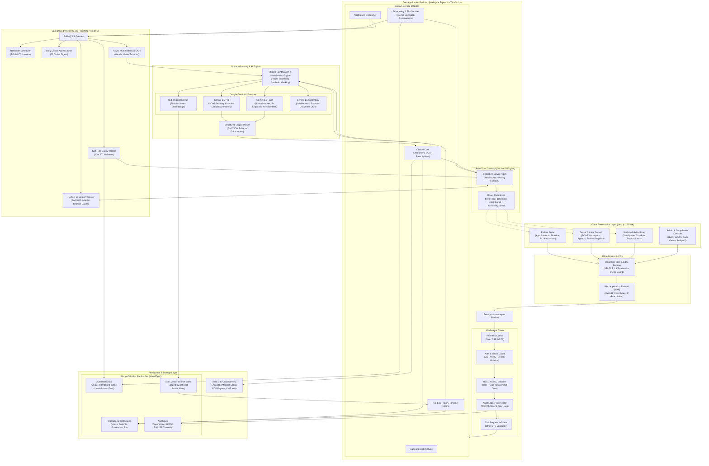
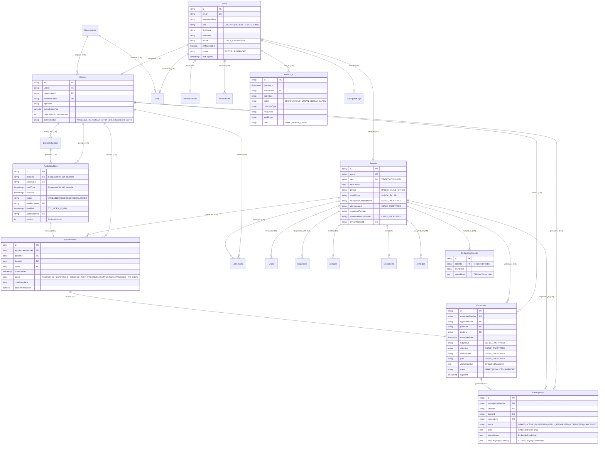
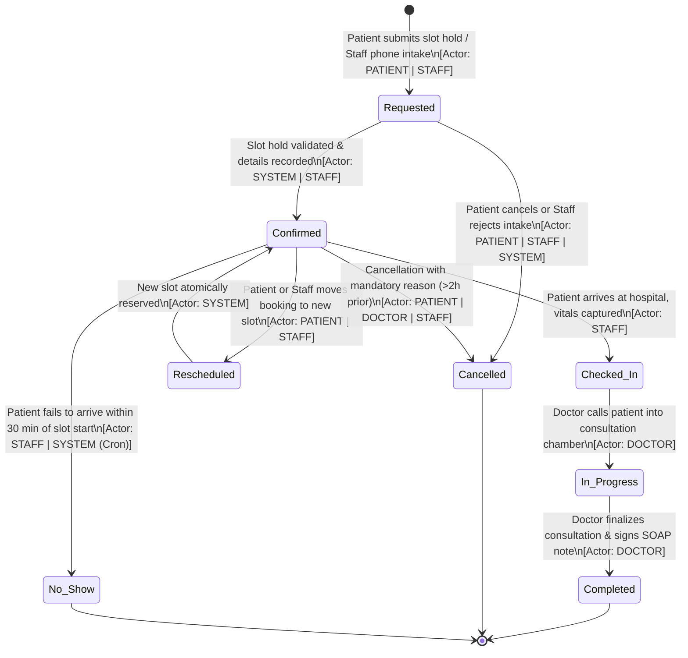
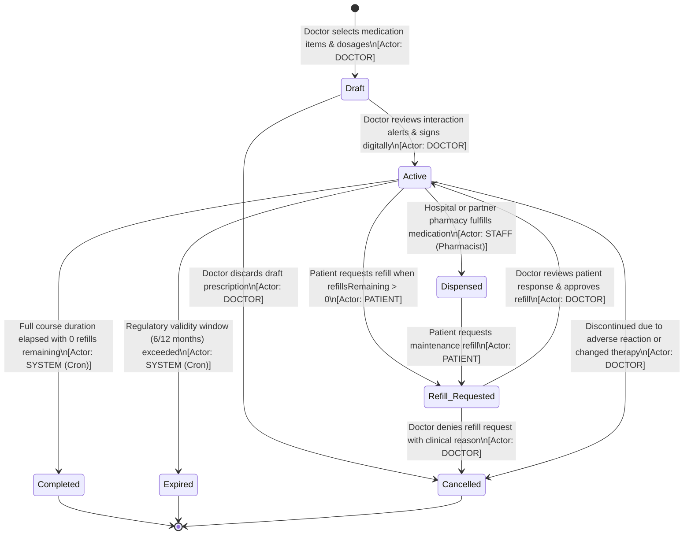

# VitalSync

[](https://github.com/adarshloopbug/prodeskcapstone-vitalsync13)
[](#3-designated-track-fullstack)
[](LICENSE)
[-10B981?style=for-the-badge)](#14-security-privacy-and-compliance)
[](#7-ai-features-deep-dive)

> **"The AI-assisted hospital management and EHR platform that gives doctors their time back and patients clarity about their care."**

VitalSync is an enterprise-grade, role-aware hospital operations and Electronic Health Record (EHR) platform. It pairs real-time outpatient coordination with assistive AI copilot services to compress administrative overhead, eliminate schedule collisions, and provide patients with transparent, jargon-free medical records.

> [!IMPORTANT]
> **STRICT COMPLIANCE & SAFETY NOTICE: SYNTHETIC DATA ONLY**  
> All patient records, clinician identities, diagnostic findings, vital signs, prescriptions, and laboratory reports throughout VitalSync are **100% synthetic**. No real Protected Health Information (PHI) or Personally Identifiable Information (PII) is ever ingested, stored, processed, or transmitted. All clinical scenarios are modeled against realistic medical benchmarks (e.g., Type 2 Diabetes Mellitus, Essential Hypertension) purely for software architecture and healthcare informatics demonstration.

---

## 2. Problem Statement and the Solution

### The Real-World Healthcare Crisis
Modern outpatient clinics and hospitals operate under severe systemic friction:
1. **Clinician Documentation Burnout:** Attending doctors spend an estimated **2 hours on clerical data entry and EHR documentation for every single hour of direct patient care**. This documentation burden drives clinician exhaustion, depersonalizes patient consultations, and causes medical coding delays.
2. **Scheduling Collisions & Clinic Capacity Waste:** Legacy clinic scheduling systems lack real-time synchronization. Uncoordinated multi-channel booking results in frequent double-bookings, while unattended no-shows squander **15% to 20% of clinic capacity**, inflating patient wait times to over 45 minutes.
3. **Fragmented Patient Records & Prescription Confusion:** Patients leave consultations with illegible paper scripts or dense medical jargon. Over **40% of patients fail to adhere to outpatient medication regimens** due to poor comprehension of drug purposes, timing, and side effects.
4. **Administrative Triage Overhead:** Front-desk receptionists lose hours manually triaging arrivals, taking phone bookings, and confirming insurance eligibility, creating congested hospital waiting rooms.

```
┌────────────────────────────────────────────────────────┐
│               Legacy EHR Bottlenecks                   │
│  2h Documentation / 1h Care  •  18% No-Show Loss Rate  │
│      Stale Slots & Double-Booking  •  Jargon Scripts   │
└───────────────────────────┬────────────────────────────┘
                            │
                            ▼ Transformed By
┌────────────────────────────────────────────────────────┐
│                   VitalSync Solution                   │
│  ✨ Ambient AI SOAP Drafting (70% Faster Notes)        │
│  🔒 Atomic Compound Slot Reservation (Zero Collisions) │
│  ⚡ Real-Time Socket.IO Availability & Triage Board    │
│  💊 Plain-Language Multi-Lingual Prescription Explainer│
│  🛡️ HIPAA-Aligned CSFLE & Immutable WORM Audit Logs    │
└────────────────────────────────────────────────────────┘
```

### The VitalSync Solution
VitalSync bridges clinical velocity and patient clarity through an integrated architecture:
- **Role-Aware Workspaces:** Dedicated, least-privilege viewports for Doctors (SOAP drafting & clinical cockpit), Patients (timeline & plain-language Rx), Front-Desk Staff (live availability board & triage queue), and Admins (WORM audit stream & analytics).
- **Atomic Slot Reservation Engine:** High-performance MongoDB reservation architecture with a unique compound index on `(doctorId, startTime)` paired with an automated 10-minute hold countdown timer to mathematically eliminate race conditions.
- **Real-Time Operational Fabric:** Socket.IO engine synchronizing doctor statuses, waiting queue progression, and slot states instantaneously across all client screens.
- **Assistive-Only Clinical AI:** Google Gemini models integrated with strict human-in-the-loop review gates, structured Zod validation, local PII scrubbing, and grounding against tenant-isolated patient vector embeddings.

---

## 3. Designated Track: Fullstack

VitalSync is developed under the **Fullstack Engineering Track**, incorporating modern frontend architecture (Next.js 15 App Router, TypeScript, Tailwind CSS, shadcn/ui), scalable backend systems (Node.js, Express, Socket.IO, BullMQ, Redis), distributed cloud persistence (MongoDB Atlas, Atlas Vector Search), and secure AI orchestration (Google Gemini API).

---

## 4. User Personas and Top User Stories

VitalSync serves four distinct operational personas across the clinical care continuum:

```
                  ┌──────────────────────────────┐
                  │       Hospital Ecosystem     │
                  └──────────────┬───────────────┘
          ┌──────────────┬───────┴───────┬──────────────┐
          ▼              ▼               ▼              ▼
   ┌─────────────┐┌─────────────┐ ┌─────────────┐┌─────────────┐
   │   Doctor    ││   Patient   │ │    Staff    ││    Admin    │
   │  Clinician  ││  Consumer   │ │ Triage/Desk ││  Compliance │
   └─────────────┘└─────────────┘ └─────────────┘└─────────────┘
```

| Persona | Core Focus | Operational Goal |
| :--- | :--- | :--- |
| **Doctor** (Dr. Priya Sharma) | Attending Physician | Efficient documentation, holistic patient history review, and safe prescribing without clerical delays. |
| **Patient** (Rajesh Patel) | Healthcare Consumer | Transparent booking, clear understanding of active prescriptions, and simplified access to clinical history. |
| **Staff / Nurse** (Ananya Sen) | Front Desk & Triage | Rapid patient intake, baseline vitals recording, and live doctor availability monitoring. |
| **Admin** (Victoria Sterling) | Hospital Compliance | User lifecycle management, tamper-evident audit inspection, and departmental capacity oversight. |

### Top User Stories with Acceptance Criteria

| ID | Persona | User Story | Acceptance Criteria (Given / When / Then) |
| :--- | :--- | :--- | :--- |
| **US-01** | **Patient** | As a patient, I want to reserve a consultation slot so that two users cannot book the same slot simultaneously. | **Given** an available slot at 10:30 AM, **When** I click to book, **Then** the system atomically locks the slot with status `HELD` for 10 minutes, broadcasts `slot:held` via Socket.IO, and prevents any concurrent user from reserving it. |
| **US-02** | **Doctor** | As a doctor, I want to dictate rough patient notes and receive a structured SOAP draft so that I can finish documentation in under 2 minutes. | **Given** an in-progress consultation, **When** I trigger "Draft with AI", **Then** the system strips PII, prompts Gemini 1.5 Pro, and populates editable Subjective, Objective, Assessment, and Plan fields with a mandatory "Review Required" verification gate. |
| **US-03** | **Doctor** | As a doctor, I want live drug-allergy warnings when prescribing so that I never prescribe contraindicated medications. | **Given** a patient with documented Penicillin anaphylaxis, **When** I add a Beta-Lactam antibiotic to the prescription builder, **Then** the UI flashes a blocking red contraindication banner citing the allergy. |
| **US-04** | **Patient** | As a patient, I want my prescription translated into plain language and Hindi so that I know exactly when and how to take my medicine. | **Given** an active prescription for Metformin 850mg BID, **When** I tap "Plain-Language Explainer", **Then** the system renders a Grade-6 reading level explanation of timing, food precautions, and purpose. |
| **US-05** | **Staff** | As front-desk staff, I want to view an AI no-show risk score for upcoming appointments so that we can send smart reminders and manage clinic overbooking. | **Given** today's appointment roster, **When** viewing the queue, **Then** appointments display a risk badge (Low, Medium, High) with contextual risk drivers (e.g., commute distance, past weather cancellations). |
| **US-06** | **Admin** | As a compliance officer, I want an immutable audit log of every PHI access so that we satisfy HIPAA audit regulations. | **Given** any read or write to a patient chart, **When** executed, **Then** an append-only log entry is committed with actor ID, IP, resource, and HMAC-SHA-256 cryptographic chain hash. |

---

## 5. Complete Tech Stack

| Layer | Technology | Architectural Justification (Why) |
| :--- | :--- | :--- |
| **Frontend Framework** | **Next.js 15 (App Router)** | Server-side rendering for initial clinical load performance and React Server Components for secure data fetching. |
| **Programming Language** | **TypeScript (Strict Mode)** | Full end-to-end type safety across DTOs, API payloads, Mongoose schemas, and AI JSON contracts. |
| **Styling & Design System**| **Tailwind CSS + shadcn/ui** | Rapid, accessible medical-grade component styling with strict WCAG 2.1 AA token consistency. |
| **Client UI State** | **Zustand** | Lean, un-opinionated store for ephemeral UI state (modals, active tabs, consultation timers, draft notes). |
| **Server State & Cache** | **TanStack Query (v5)** | Declarative server-state caching, automatic background revalidation, and optimistic mutation rollbacks. |
| **Forms & Validation** | **React Hook Form + Zod** | High-performance uncontrolled form inputs with isomorphic schema validation matching backend DTOs. |
| **Backend Runtime** | **Node.js + Express + TypeScript** | Mature, non-blocking asynchronous I/O runtime optimized for high-concurrency healthcare workflows. |
| **Real-Time Engine** | **Socket.IO (v4.8)** | Bidirectional WebSocket multiplexing with automatic fallback for live doctor status and slot state distribution. |
| **Primary Database** | **MongoDB Atlas (Replica Set)** | Flexible document model accommodating hierarchical EHR records, SOAP notes, and embedded prescription items. |
| **Vector Database** | **Atlas Vector Search** | Native k-NN vector indexing on 768-dim embeddings co-located with clinical data, eliminating external sync drift. |
| **Job Queue & Cache** | **BullMQ + Redis 7** | Distributed in-memory queue for atomic slot hold timeouts (10m TTL), reminder cron jobs, and async AI batch tasks. |
| **AI LLM Engine** | **Google Gemini 1.5 Pro & Flash** | State-of-the-art reasoning for clinical SOAP synthesis, large multimodal context, and ultra-low latency inference. |
| **AI Embeddings** | **text-embedding-004** | High-density 768-dimensional clinical semantic embeddings supporting scoped RAG queries over medical timelines. |
| **Security & Cryptography**| **CSFLE + bcrypt + JWT** | AES-256 Client-Side Field-Level Encryption for PHI, salted password hashing, and rotating JWT token families. |
| **Cloud Storage** | **AWS S3 / Cloudflare R2** | KMS-SSE encrypted object storage for diagnostic imaging, uploaded lab scans, and PDF summaries. |
| **DevOps & Monitoring** | **Docker + GitHub Actions + Sentry** | Containerized reproducible deployments, automated CI lint/test pipelines, and real-time exception tracking. |

---

## 6. Prioritized Core Features

### P0: Core EHR Engine (Mandatory Foundation)
- [x] **Authentication & Token Lifecycle:** Email/password + Google OAuth 2.0, dual JWT (15-min access + rotating 7-day refresh), automated session expiry, and CSRF protection.
- [x] **Role-Based Access Control (RBAC):** Route guards on Next.js and middleware on Express enforcing least-privilege partitions across Doctor, Patient, Staff, and Admin.
- [x] **Atomic Appointment Scheduling:** Doctor weekly template scheduling, slot generation, buffer time calculations, and atomic slot holds backed by a unique compound index on `(doctorId, startTime)`.
- [x] **Appointment Lifecycle State Machine:** Strict transitions (`Requested` → `Confirmed` → `Checked-In` → `In-Progress` → `Completed`, plus `Cancelled`, `No-Show`, `Rescheduled`).
- [x] **Real-Time Operational Fabric:** Socket.IO broadcasting for doctor availability (`Available`, `In Consultation`, `On Break`, `Off Duty`), slot lock events, and waiting room queue count.
- [x] **Chronological Medical Timeline:** Unified, filterable feed of encounters, diagnoses, vitals, lab results, allergies, and prescriptions.
- [x] **Prescription State Lifecycle:** Finite state progression (`Draft` → `Active` → `Dispensed` → `Refill Requested` → `Completed`, `Expired`, `Cancelled`) with embedded items and status history.

### P1: Clinical Workflow
- [x] **SOAP Clinical Note Workspace:** Structured editor dividing Subjective, Objective, Assessment, and Plan fields with auto-save and digital clinician sign-off.
- [x] **Vitals Recording & Sparklines:** Point-of-care capture of BP, HR, Temp, SpO2, Respiratory Rate, Weight, Height, and automatic BMI calculation.
- [x] **Diagnostic Labs & Document Attachments:** Tabular display of LOINC-coded lab readings with abnormal range flags and encrypted file attachments.
- [x] **Prescribing Safety & Allergy Engine:** Synchronous rule-based cross-referencing of proposed medications against patient documented drug allergies and drug-drug interactions.
- [x] **Automated Notification Service:** BullMQ scheduled reminders at T-24h and T-2h, refill readiness alerts, and a daily 06:00 AM doctor agenda digest.
- [x] **Immutable WORM Audit Viewer:** Admin console inspecting tamper-evident access logs sealed with HMAC-SHA-256 cryptographic chaining.

### P2: AI Assistive Layer (The Differentiator)
- [x] **AI Pre-Visit Intake Assistant:** Conversational patient symptom intake producing a structured pre-visit summary with automated red-flag emergency detection.
- [x] **AI Encounter Note Drafting:** Ambient dictation and rough scratchpad conversion into structured SOAP drafts with confidence scoring.
- [x] **AI Patient History Summarizer:** One-screen executive clinical snapshot synthesizing chronic conditions, recent changes, active medications, and allergies with source citations.
- [x] **Plain-Language Prescription Explainer:** Patient-facing translation explaining drug purpose, dosing schedule, and precautions in plain English and Hindi at a Grade-6 reading level.
- [x] **Smart Scheduling Recommendations:** Slot optimization algorithm recommending ideal booking times based on doctor specialty, urgency, and clinic wait patterns.
- [x] **No-Show Risk Predictor:** Machine-learning risk scoring factoring in weather forecasts, commute distance, and past attendance to drive proactive reminders and smart overbooking.
- [x] **Semantic "Ask VitalSync" RAG:** Natural language querying over patient charts powered by Atlas Vector Search with strict tenant-isolated vector filtering (`patientId`).
- [x] **Multimodal Lab Report Extraction:** Gemini Vision extraction parsing uploaded lab PDFs and scan images into structured LOINC analyte key-value pairs.

### P3: Platform Polish & Extensions
- [x] **Hospital Analytics Dashboard:** Aggregated KPI telemetry tracking patient throughput, average wait times, no-show percentages, and departmental utilization.
- [x] **Telemedicine Consultation Screen:** Low-latency WebRTC video consultation placeholder interface with embedded SOAP scratchpad.
- [x] **PDF Document Generator:** Exportable clinical encounter summaries and tamper-proof prescription slips with digital signature stamps.
- [x] **Accessibility & Dark Mode:** WCAG 2.1 AA compliant color tokens, system dark mode support, and keyboard navigation shortcuts.

---

## 7. AI Features Deep Dive

Every AI feature in VitalSync is engineered with an unwavering safety standard: **Assistive, never diagnostic**. All models run behind local PII minimization filters, enforce strict Zod schemas, and require explicit human-in-the-loop clinical review.

```
┌────────────────────────────────────────────────────────────────────────┐
│                        VitalSync AI Safety Engine                      │
├────────────────────────────────────────────────────────────────────────┤
│  [User Query / Clinician Audio]                                        │
│          │                                                             │
│          ▼                                                             │
│  ┌──────────────────────────┐                                          │
│  │ Local PII/PHI Redaction  │ ──► Replaces direct identifiers          │
│  └───────────┬──────────────┘                                          │
│              ▼                                                         │
│  ┌──────────────────────────┐                                          │
│  │ Gemini 1.5 Orchestrator  │ ──► Low Temperature (0.1 - 0.2), JSON    │
│  └───────────┬──────────────┘                                          │
│              ▼                                                         │
│  ┌──────────────────────────┐                                          │
│  │ Zod Schema Verification  │ ──► Rejects malformed / unverified keys  │
│  └───────────┬──────────────┘                                          │
│              ▼                                                         │
│  ┌──────────────────────────┐                                          │
│  │ Human-in-the-Loop Signoff│ ──► Clinician reviews diff & signs       │
│  └───────────┬──────────────┘                                          │
│              ▼                                                         │
│  [Committed to EHR with Immutable Audit Record]                        │
└────────────────────────────────────────────────────────────────────────┘
```

### Feature 1: AI Pre-Visit Intake Assistant
- **What It Does:** Conducts an empathetic, conversational pre-visit symptom intake with the patient prior to consultation. Extracts chief complaint, onset, severity, and aggravating factors into a structured brief for the attending clinician.
- **Input:** Patient natural language text input + appointment metadata.
- **Output Schema:**
  ```json
  {
    "chiefComplaint": "Persistent morning dizziness and polydipsia",
    "duration": "3 weeks",
    "severityScale1To10": 4,
    "associatedSymptoms": ["Thirst", "Mild blurred vision"],
    "redFlagsIdentified": false,
    "urgencyLevel": "ROUTINE",
    "patientContext": "History of Type 2 Diabetes"
  }
  ```
- **Underlying Model:** Google Gemini 1.5 Flash.
- **Human-in-the-Loop Rule:** Output is saved as a *draft intake brief*. The doctor must review and verify the summary at the start of the consultation.
- **Emergency Fallback:** If red flags are detected (e.g., crushing chest pain, sudden unilateral numbness), the AI conversation terminates immediately, and the UI displays a high-contrast emergency banner advising the patient to call emergency services (112 / 911).
- **Mandatory Disclaimer:** *"VitalSync AI provides intake assistance, not a medical diagnosis. In case of medical emergencies, immediately contact local emergency services."*

### Feature 2: AI Encounter-Note Drafting
- **What It Does:** Transforms clinician dictate-audio or bullet-point scratchpad impressions into a structured, ICD-10 codified SOAP note.
- **Input:** Unstructured clinical text + today's triage vitals + active diagnoses list.
- **Output Schema:**
  ```json
  {
    "subjective": "42-year-old male with established Type 2 Diabetes presents for scheduled checkup...",
    "objective": "BP: 138/88 mmHg, HR: 76 bpm. Alert, oriented. Heart sounds regular. No peripheral edema.",
    "assessment": "1. Type 2 Diabetes Mellitus (ICD-10: E11.9) - Sub-optimal glycemic control.\n2. Essential Hypertension (ICD-10: I10) - Moderately elevated.",
    "plan": "1. Increase Metformin to 850mg PO BID.\n2. Recheck HbA1c in 90 days.\n3. Home BP monitoring.",
    "confidenceScore": 0.94
  }
  ```
- **Underlying Model:** Google Gemini 1.5 Pro.
- **Human-in-the-Loop Rule:** The generated SOAP note is displayed in an editable side-by-side diff workspace. An attending physician must review, edit where necessary, and apply their digital signature before the note can be sealed.
- **Fallback Behavior:** If model latency exceeds 5 seconds or JSON parsing fails, the workspace preserves the doctor's raw text verbatim with a warning: *"AI draft unavailable. Manual documentation active."*
- **Mandatory Disclaimer:** *"AI-generated clinical draft. Clinician review, amendment, and digital signature required prior to legal medical record finalization."*

### Feature 3: AI Patient History Summarizer
- **What It Does:** Condenses years of fragmented patient timeline events into an executive 360-degree clinical brief.
- **Input:** Aggregated patient timeline documents (last 10 encounters, active diagnoses, lab trends, active prescriptions).
- **Output:** One-screen digest highlighting chronic conditions, recent medication alterations, notable lab deviations, and upcoming preventative milestones with clickable source citation chips.
- **Underlying Model:** Google Gemini 1.5 Pro.
- **Human-in-the-Loop Rule:** Used strictly as an ambient navigation aid for clinicians; cannot be exported as an official medical legal record without doctor verification.
- **Fallback Behavior:** Renders raw chronological card list if synthesis is unavailable.
- **Mandatory Disclaimer:** *"Synthesized clinical overview. Always verify primary diagnostic reports before clinical decisions."*

### Feature 4: Plain-Language Prescription Explainer
- **What It Does:** Translates clinical pharmacy orders into clear, accessible language formatted at a Grade-6 reading level in both English and Hindi.
- **Input:** Prescription document `{ medicationName, dosage, frequency, duration, route, instructions }`.
- **Output:**
  ```json
  {
    "language": "en",
    "readingLevel": "Grade 6",
    "explanation": "Metformin helps lower blood sugar. Take 1 pill twice a day with breakfast and dinner to avoid stomach upset.",
    "precautions": "Drink plenty of water. Do not consume excessive alcohol while on this medicine."
  }
  ```
- **Underlying Model:** Google Gemini 1.5 Flash.
- **Human-in-the-Loop Rule:** Pharmacist or prescribing doctor approves the translated explanation chip during prescription issuance.
- **Fallback Behavior:** Displays the original physician Latin sig instructions (e.g., `1 tab PO BID pc`).
- **Mandatory Disclaimer:** *"This explanation is an educational aid. Always follow instructions given by your doctor and pharmacist."*

### Feature 5: Smart Scheduling Recommendations
- **What It Does:** Suggests optimal consultation slots by analyzing doctor specialty, patient appointment urgency, historical traffic patterns, and clinic wait duration curves.
- **Input:** Patient search parameters, doctor schedule templates, clinic wait telemetry.
- **Output:** Top 3 ranked slots with transparent reasoning (e.g., *"Recommended: Tuesday 10:30 AM — Dr. Sharma's lowest clinic wait time (8 min) and matches your routine morning visit pattern"*).
- **Underlying Model:** Heuristic optimization combined with Gemini 1.5 Flash.
- **Human-in-the-Loop Rule:** Patient or front-desk staff has total autonomy to select any available slot regardless of AI ranking.
- **Fallback Behavior:** Displays standard chronological slot list sorted by time.
- **Mandatory Disclaimer:** *"Suggested slots are recommendations based on clinic throughput averages."*

### Feature 6: No-Show Risk Predictor
- **What It Does:** Computes a per-appointment cancellation/no-show risk probability (0.00 to 1.00) to optimize front-desk reminder cadences and enable controlled overbooking.
- **Input:** Patient appointment history, interval since last visit, day of week, weather forecast, commute distance.
- **Output:** Risk score + driver explanations (e.g., `Risk: 64% (High) • Reasons: 2 consecutive missed rainy appointments, 24km commute distance`).
- **Underlying Model:** Gemini 1.5 Flash structured regression prompt.
- **Human-in-the-Loop Rule:** Front-desk staff uses the score to trigger manual WhatsApp/phone verifications; appointments are never cancelled automatically by the AI.
- **Fallback Behavior:** Defaults risk score to `NORMAL` (baseline clinic average 12%).
- **Mandatory Disclaimer:** *"Operational predictive indicator. Does not impact patient care eligibility."*

### Feature 7: Semantic "Ask VitalSync" Assistant (RBAC RAG)
- **What It Does:** Delivers grounded conversational answers to patient queries (e.g., *"What was my last blood pressure?"*) and doctor queries (e.g., *"Summarize cardiac lab trends for this patient"*).
- **Input:** User natural language query + authenticated `patientId` session token.
- **Output:** Grounded narrative response with clickable source citations referencing exact `Encounter` or `LabResult` document IDs.
- **Underlying Model:** `text-embedding-004` (Retrieval) + Gemini 1.5 Flash (Generation).
- **Human-in-the-Loop Rule:** System strictly prompts the LLM to refuse ungrounded speculation: *"If the answer cannot be found in the provided records, state that the information is not documented."*
- **Fallback Behavior:** Displays standard search bar querying keyword index.
- **Mandatory Disclaimer:** *"VitalSync AI provides informational retrieval over documented records only. Consult your doctor for medical advice."*

### Feature 8: Multimodal Lab & Report Extraction
- **What It Does:** Ingests scanned lab reports (PDF/JPEG) and parses them into structured, LOINC-coded numerical records.
- **Input:** File stream / image bytes of diagnostic lab report.
- **Output:** Array of parsed analytes with measured value, unit, reference range, and abnormal flag.
- **Underlying Model:** Gemini 1.5 Multimodal Vision API.
- **Human-in-the-Loop Rule:** Extracted values are presented in a staging review table where a clinician or lab technician must review and confirm before values are committed to the patient's longitudinal record.
- **Fallback Behavior:** Preserves raw PDF document for manual clinician entry.
- **Mandatory Disclaimer:** *"Extracted via OCR/Vision AI. Human confirmation of analyte values is mandatory."*

---

## 8. Wireframes Section

> **Figma Design Canvas:**  
> **[ADD PUBLIC FIGMA LINK HERE]**  
> *(Designers: Refer to [`docs/design/design-system.md`](docs/design/design-system.md) and [`docs/design/wireframe-specs.md`](docs/design/wireframe-specs.md) for exact 1440px auto-layout frames, tokens, and component variants).*

Interactive static wireframe prototypes can be launched locally by opening [`docs/design/wireframes/index.html`](docs/design/wireframes/index.html).

### Viewport Previews & Image Embed Placeholders

#### Screen 1: Authentication & Role Gate
Split-screen authentication with 4-way clinical role switcher, Google Health SSO, and HIPAA trust credentials.

*(Reference HTML: [`docs/design/wireframes/screen1-auth.html`](docs/design/wireframes/screen1-auth.html))*

---

#### Screen 2: Patient Health Dashboard
Comprehensive patient portal featuring the AI Health Snapshot, upcoming consultation card, vitals sparkline grid, active prescriptions table, and RAG health assistant.

*(Reference HTML: [`docs/design/wireframes/screen2-patient-dashboard.html`](docs/design/wireframes/screen2-patient-dashboard.html))*

---

#### Screen 3: Smart Appointment Booking
3-column booking workflow with doctor specialty filters, interactive month calendar, color-coded live slots, AI scheduling recommendation, and 10-minute atomic hold lock.

*(Reference HTML: [`docs/design/wireframes/screen3-book-appointment.html`](docs/design/wireframes/screen3-book-appointment.html))*

---

#### Screen 4: Doctor Clinical Cockpit
Attending doctor command center with real-time availability toggle (`Available`, `In Consult`, `Break`), today's agenda timeline, live waiting room queue, and next patient AI brief.

*(Reference HTML: [`docs/design/wireframes/screen4-doctor-dashboard.html`](docs/design/wireframes/screen4-doctor-dashboard.html))*

---

#### Screen 5: Patient Record & Medical Timeline
360-degree patient chart with sticky header, high-risk Penicillin allergy banner, tabbed flowsheet navigation, and filterable chronological timeline spine.

*(Reference HTML: [`docs/design/wireframes/screen5-patient-record-timeline.html`](docs/design/wireframes/screen5-patient-record-timeline.html))*

---

#### Screen 6: Clinical Encounter & Prescription Workspace
Split clinical workstation featuring the AI-assisted SOAP note editor with review chips, live drug-allergy and drug-drug interaction checker, plain-language explainer, and digital signing bar.

*(Reference HTML: [`docs/design/wireframes/screen6-encounter-prescription.html`](docs/design/wireframes/screen6-encounter-prescription.html))*

---

#### Screen 7: Staff Availability Board & Triage Queue
Hospital operations grid displaying doctors across hourly time slots with real-time status badges, arrived patient check-in table, and AI no-show risk predictor column.

*(Reference HTML: [`docs/design/wireframes/screen7-staff-availability-board.html`](docs/design/wireframes/screen7-staff-availability-board.html))*

---

#### Screen 8: Admin & Compliance Console
Enterprise management console with hospital KPI analytics, RBAC user provisioning table, and immutable WORM audit log stream with HMAC-SHA-256 chain verification.

*(Reference HTML: [`docs/design/wireframes/screen8-admin-console.html`](docs/design/wireframes/screen8-admin-console.html))*

---

## 9. System Architecture Overview

VitalSync connects modern edge client applications to a secure Node.js application core, distributed MongoDB/Redis storage, background worker clusters, and privacy-shielded Google Gemini AI services.



*(Source file: [`docs/architecture/system-architecture.mmd`](docs/architecture/system-architecture.mmd))*

---

## 10. Entity-Relationship Diagram (ERD)


VitalSync uses a hybrid document store schema in MongoDB Atlas. Operational collections (such as `Patients`, `Doctors`, `Encounters`, and `AvailabilitySlots`) use referenced relations to segregate security domains and prevent unbounded growth, while atomic sub-domains (such as prescription drug items, vitals snapshots, and status history logs) use embedded document patterns.



*(Complete DBML definition: [`docs/architecture/erd.dbml`](docs/architecture/erd.dbml); Mermaid source: [`docs/architecture/erd.mmd`](docs/architecture/erd.mmd)).*

---

## 11. State Machines

### 11.1 Appointment Lifecycle State Machine
Guarded by role permissions. Only staff or patient can initiate check-in; only an attending doctor can start and complete consultations.



### 11.2 Prescription Lifecycle State Machine
Tracks active medication regimens from physician draft through pharmacy fulfillment and refill cycles.



*(Source file: [`docs/architecture/state-machines.mmd`](docs/architecture/state-machines.mmd))*

---

## 12. API Endpoint Overview

All endpoints adhere to RESTful conventions, return strict JSON envelopes, and enforce bearer JWT authentication with RBAC/ABAC middleware.

| Module | Method & Route | Role Required | Description |
| :--- | :--- | :--- | :--- |
| **Auth** | `POST /api/v1/auth/login` | Public | Authenticates credentials, issues access + refresh tokens. |
| **Auth** | `POST /api/v1/auth/refresh` | Public | Rotates refresh token family and issues new access token. |
| **Doctors** | `GET /api/v1/doctors` | Authenticated | Lists doctors with specialty, fee, and live status. |
| **Doctors** | `PATCH /api/v1/doctors/:id/status` | `DOCTOR`, `STAFF` | Updates availability status (Available, Consult, Break, Off Duty). |
| **Availability**| `GET /api/v1/availability/slots` | Authenticated | Queries slots for a doctor & date with hold states. |
| **Availability**| `POST /api/v1/availability/slots/:id/hold` | `PATIENT`, `STAFF` | Atomically locks slot for 10m countdown. |
| **Appointments**| `POST /api/v1/appointments` | `PATIENT`, `STAFF` | Confirms held slot into confirmed appointment. |
| **Appointments**| `PATCH /api/v1/appointments/:id/status`| Scoped | Manages check-in, consultation start, and completion. |
| **Patients** | `GET /api/v1/patients/:id` | Scoped (Care Rel) | Retrieves 360-degree patient demographics and problem list. |
| **Timeline** | `GET /api/v1/patients/:id/timeline` | Scoped | Returns chronological unified medical history. |
| **Encounters** | `POST /api/v1/encounters` | `DOCTOR` | Saves draft or finalizes SOAP encounter note. |
| **Encounters** | `POST /api/v1/encounters/:id/sign` | `DOCTOR` (Attending) | Seals encounter note with doctor digital signature stamp. |
| **Vitals** | `POST /api/v1/vitals` | `STAFF`, `DOCTOR` | Captures point-of-care vitals with automatic BMI calculation. |
| **Prescriptions**| `POST /api/v1/prescriptions` | `DOCTOR` | Issues prescription after allergy/interaction checks. |
| **AI Intake** | `POST /api/v1/ai/intake/chat` | `PATIENT` | Conversational symptom intake with red-flag detection. |
| **AI SOAP** | `POST /api/v1/ai/encounters/draft-soap` | `DOCTOR` | Ambient dictate-to-SOAP note drafting copilot. |
| **AI Rx** | `POST /api/v1/ai/prescriptions/:id/explain` | `PATIENT`, `DOCTOR` | Plain-language prescription explanation in English/Hindi. |
| **AI RAG** | `POST /api/v1/ai/rag/query` | Scoped (ABAC) | Semantic RAG retrieval scoped to patient vector chunks. |
| **Admin Audit** | `GET /api/v1/admin/audit-logs` | `ADMIN` | Queries immutable WORM access log with hash chain checks. |
| **Analytics** | `GET /api/v1/analytics/dashboard` | `ADMIN` | Hospital throughput KPIs (volume, wait time, no-show rate). |

> **Full Specification:** See [`docs/architecture/api-spec.md`](docs/architecture/api-spec.md) for full request/response schemas, error codes, and the complete Socket.IO event catalog.

---

## 13. Role-Based Access Control (RBAC) Summary

VitalSync operates a multi-tiered security matrix combining **RBAC** role capabilities with **ABAC** dynamic attribute evaluation:

```
[ Request Ingress ]
       │
       ▼
[ RBAC Gate ] ───► Does role have general permission on resource? (e.g., Can DOCTOR write Encounters?)
       │ YES
       ▼
[ ABAC Gate ] ───► Does actor have a direct relationship with this specific patient?
       │ YES
       ▼
[ Attribute Projection ] ──► Strip sensitive narrative fields for STAFF
       │
       ▼
[ Authorized Execution ]
```

### Core ABAC Principles
1. **Patient Tenant Isolation:** A user with role `PATIENT` can only read, book, or query records where `patientId === req.user.patientId`. Vector embeddings in Atlas Vector Search are hard-filtered by `patientId` during pre-retrieval.
2. **Doctor Care Relationship:** A `DOCTOR` can access patient charts only if an active, past, or scheduled appointment exists linking them, or if designated as the patient's primary care provider.
3. **Staff Narrative Shielding:** Front-desk staff and triage nurses can register patients, manage check-in, and record vitals, but database projections automatically strip detailed clinical SOAP notes (`subjective`, `assessment`, `plan`).
4. **Emergency Break-Glass:** In emergency life-safety scenarios, an unassigned physician can invoke emergency break-glass access by submitting a mandatory clinical justification. This immediately issues a 2-hour emergency token, appends a high-priority entry to the immutable audit log, and notifies the Hospital Compliance Officer.

*(Detailed role × resource matrix: [`docs/architecture/rbac-matrix.md`](docs/architecture/rbac-matrix.md)).*

---

## 14. Security, Privacy and Compliance

- **HIPAA-Aligned Principles:** Designed to comply with HIPAA Security, Privacy, and Breach Notification rules. Implements least privilege, role segregation, automated session timeouts (15 minutes of inactivity), and emergency data access protocols.
- **Client-Side Field-Level Encryption (CSFLE):** High-risk Tier 1 PHI fields (`phone`, `addressLine1`, `emergencyContactPhone`, and subjective clinical narratives) are encrypted using AES-256-GCM before transmission over the database wire. Database administrators cannot view plaintext PHI.
- **Immutable WORM Audit Trail:** Every mutating request and PHI read generates an append-only log record in `AuditLogs`. Log records are linked using HMAC-SHA-256 cryptographic chaining (`hash = HMAC(prevHash + timestamp + actor + action)`), making retroactive tampering instantly detectable.
- **AI De-Identification Gateway:** All user inputs and clinical notes pass through a local regex and tokenization de-identification engine that scrubs direct identifiers (names, phone numbers, Aadhaar/SSN, addresses) before dispatching prompts to Google Gemini API.

*(Full security architecture: [`docs/architecture/security-compliance.md`](docs/architecture/security-compliance.md)).*

---

## 15. Non-Functional Requirements (NFRs)

| Dimension | Target Standard | Architectural Mechanism |
| :--- | :--- | :--- |
| **API Response Time** | &lt; 200 ms (p95) for standard reads/writes | MongoDB compound indexing, Redis caching, lean Mongoose query projections. |
| **AI Inference Latency**| &lt; 1,500 ms (p95) for Flash; &lt; 3,500 ms for Pro | Low-temperature parameter tuning, streaming JSON parsing, PII pre-caching. |
| **System Availability** | 99.9% Uptime (Outpatient Core) | Multi-AZ MongoDB Atlas replica set, stateless containerized Express servers, Cloudflare edge failover. |
| **Concurrency & Locking**| 0 Double-Bookings per 1,000,000 slots | Atomic MongoDB `findOneAndUpdate` with unique compound index `(doctorId, startTime)` and versioning. |
| **Accessibility** | WCAG 2.1 Level AA Compliance | 4.5:1 text contrast ratios, full keyboard tab-indexing, screen-reader aria attributes, and large-text scaling. |
| **Data Protection** | RPO &lt; 1 min • RTO &lt; 15 min | Continuous MongoDB Atlas point-in-time recovery (PITR) with automated daily snapshot validation. |

---

## 16. Success Metrics and KPIs

| Metric Category | Target Objective | Measurement Method |
| :--- | :--- | :--- |
| **Clinician Documentation Velocity** | **70% Reduction** in SOAP note drafting time | Timer tracking from encounter opening to digital signature commit (`AIInsights` telemetry). |
| **Clinic Capacity Optimization** | **60% Reduction** in appointment no-show loss | Ratio of `NO_SHOW` appointment states vs baseline historical rates pre- and post-AI risk reminders. |
| **Double-Booking Rate** | **Strictly 0.0%** scheduling collisions | Database integrity monitoring asserting zero unique compound index violation panics. |
| **Patient Prescription Comprehension**| **&gt; 90%** patient comprehension score | Patient portal survey following "Plain-Language Explainer" interaction. |
| **Audit Trail Verification** | **100% Chain Integrity** across all quarters | Automated cron verifying HMAC-SHA-256 link integrity across historical `AuditLogs`. |

---

## 17. Risks and Mitigations

| Identified Risk | Severity | Architectural Mitigation in VitalSync |
| :--- | :---: | :--- |
| **AI Hallucination in Clinical Notes** | **CRITICAL** | Strict human-in-the-loop review gate: AI drafts cannot become legal medical records without an attending doctor's explicit diff review, edits, and digital signature. Low model temperature (0.1) and grounding against verified patient context. |
| **Cross-Tenant Vector Data Leakage** | **CRITICAL** | Hard tenant isolation in Atlas Vector Search pre-filter (`{ patientId: req.user.patientId }`). Queries never execute vector cosine similarity without an authenticated patient scope constraint. |
| **Slot Race Conditions During High Traffic** | **HIGH** | Unique compound database index on `(doctorId, startTime)` guarantees physical uniqueness. Atomic `findOneAndUpdate` sets slot to `HELD` with an automated 10-minute TTL hold countdown. |
| **Clinician Alert Fatigue** | **MEDIUM** | Prescription interaction warnings are stratified into three severity tiers (Mild, Moderate, Severe). Only life-threatening drug-allergy contraindications present blocking modal dialogs. |
| **Third-Party AI Outages** | **MEDIUM** | Graceful degradation architecture: if Gemini API is unreachable, clinical note and booking workflows instantly revert to standard manual entry modes without workflow stoppage. |

---

## 18. 6-Week Implementation Roadmap

```
Week 1: Foundations & Auth ──► Week 2: Core EHR & Scheduling ──► Week 3: Real-Time Engine
                                                                         │
Week 6: Launch & Governance ◄── Week 5: Clinical Workflows ◄─── Week 4: Assistive AI Layer
```

- **Week 1: Identity, Auth & Data Schemas**
  - Initialize monorepo structure (Turborepo + Next.js 15 + Express + TypeScript).
  - Deploy MongoDB Atlas cluster, configure CSFLE key vault, and apply Mongoose schemas.
  - Implement JWT auth, refresh token rotation family, and RBAC route middleware.
- **Week 2: Atomic Scheduling & Doctor Workspaces**
  - Implement doctor shift schedule templates and slot generation worker.
  - Implement atomic slot reservation endpoint with unique compound index and 10-minute hold lock.
  - Build Screen 1 (Auth) and Screen 3 (Smart Booking) frontend workflows.
- **Week 3: Real-Time Infrastructure & Operational Board**
  - Configure Socket.IO server with Redis adapter and room authorization gates.
  - Implement live slot status synchronization (`slot:held`, `slot:released`, `slot:booked`).
  - Build Screen 4 (Doctor Dashboard) and Screen 7 (Staff Availability Board).
- **Week 4: AI Copilot & Privacy Redaction Pipeline**
  - Implement local PII minimization engine and prompt template orchestrator.
  - Integrate Google Gemini 1.5 Pro for ambient SOAP note drafting with Zod validation.
  - Build conversational pre-visit intake assistant with emergency red-flag rules.
  - Configure Atlas Vector Search index on `EmbeddingChunks` and implement RBAC-scoped RAG assistant.
- **Week 5: Clinical Workflows & Safety Engine**
  - Build Screen 6 (Encounter & Prescription Workspace) with live allergy warning chips.
  - Implement plain-language prescription explainer with multi-lingual Hindi/English synthesis.
  - Build Screen 2 (Patient Health Dashboard) and Screen 5 (360° Medical Timeline).
- **Week 6: Governance, Audit, Hardening & Final Polishing**
  - Implement immutable WORM audit logging with HMAC-SHA-256 cryptographic chaining.
  - Build Screen 8 (Admin & Compliance Console) with hospital KPI telemetry.
  - Run full WCAG 2.1 AA accessibility audit, execute concurrency load testing, and finalize documentation.

---

## 19. Monorepo Folder Structure Plan

```
prodesk-capstone-VitalSync/
├── apps/
│   ├── web/                              # Next.js 15 App Router Frontend
│   │   ├── app/
│   │   │   ├── (auth)/login/page.tsx     # Screen 1: Auth & Role Selection
│   │   │   ├── (patient)/
│   │   │   │   ├── dashboard/page.tsx    # Screen 2: Patient Dashboard
│   │   │   │   ├── book/page.tsx         # Screen 3: Book Appointment
│   │   │   │   └── timeline/page.tsx     # Patient Medical Timeline View
│   │   │   ├── (doctor)/
│   │   │   │   ├── dashboard/page.tsx    # Screen 4: Doctor Cockpit & Queue
│   │   │   │   ├── patients/[id]/page.tsx# Screen 5: 360° Patient Chart
│   │   │   │   └── encounter/[id]/page.tsx# Screen 6: SOAP & Rx Workspace
│   │   │   ├── (staff)/
│   │   │   │   └── board/page.tsx        # Screen 7: Staff Availability Board
│   │   │   └── (admin)/
│   │   │       └── console/page.tsx      # Screen 8: Admin & WORM Audit Console
│   │   ├── components/                   # shadcn/ui & Clinical Design System
│   │   │   ├── ui/                       # Buttons, Modals, Badges, Tabs
│   │   │   ├── clinical/                 # VitalsTile, SOAPDiffViewer, RxBuilder
│   │   │   └── ai/                       # AISparkleChip, IntakeAssistantModal
│   │   ├── hooks/                        # useSocket, useAtomicHold, useTimeline
│   │   └── stores/                       # Zustand UI Stores
│   │
│   └── api/                              # Node.js + Express + TypeScript Backend
│       ├── src/
│       │   ├── middleware/               # Auth, RBAC, ABAC, CSFLE, AuditHook, Zod
│       │   ├── modules/
│       │   │   ├── auth/                 # Login, Register, Token Rotation
│       │   │   ├── doctors/              # Profiles, Status Toggles
│       │   │   ├── availability/         # Slot Generation, Atomic Reservation
│       │   │   ├── appointments/         # Appointment Lifecycle State Machine
│       │   │   ├── clinical/             # Encounters, SOAP Notes, Prescriptions
│       │   │   ├── vitals/               # Vitals Time-Series
│       │   │   ├── ai/                   # Gemini Orchestrator, Redaction, RAG
│       │   │   └── admin/                # WORM Audit Logs, Analytics
│       │   ├── realtime/                 # Socket.IO Gateway & Room Handlers
│       │   └── workers/                  # BullMQ Job Processors (Holds, Reminders)
│       └── server.ts
│
├── packages/
│   ├── types/                            # Shared TypeScript Interfaces & DTOs
│   ├── schemas/                          # Shared Zod Validation Schemas
│   └── config/                           # Tailwind & ESLint Shared Configs
│
├── docs/                                 # Complete Architectural Blueprint
│   ├── architecture/                     # DBML, MMD diagrams, API spec, RBAC
│   ├── design/                           # Design tokens, wireframe specs, HTML
│   └── assets/                           # Rendered PNGs and diagram visuals
│
├── .github/                              # CI workflows & PR/Issue templates
├── LICENSE                               # MIT License
└── README.md                             # Enterprise PRD & Architecture Blueprint
```

---

## 20. Design Decisions and Trade-offs

### 1. Why MongoDB for an Enterprise EHR Platform?
- **Decision:** Use MongoDB Atlas over a traditional relational database (PostgreSQL).
- **Rationale:** Healthcare encounter records are inherently semi-structured and hierarchical. A clinical encounter contains nested SOAP observations, point-of-time vitals snapshots, and variable diagnostic findings. MongoDB allows modeling these entities naturally without 12-table relational joins, while Atlas Vector Search enables seamless co-location of clinical narrative vector embeddings within the same database engine.
- **Trade-off & Mitigation:** MongoDB lacks cross-collection foreign key constraints by default. We mitigate this by using strict Mongoose relational schema validation, multi-document ACID transactions during booking finalization, and optimistic concurrency versioning.

### 2. Referenced vs. Embedded Modeling Rationale
- **Decision:** Reference top-level clinical actors (`Patients`, `Doctors`, `Encounters`) while embedding bounded sub-documents (`Prescription.items`, `Encounter.vitalsSnapshot`, `Prescription.statusHistory`).
- **Rationale:** Embedding unbounded historical records (e.g., all vitals over 10 years inside a Patient document) would violate the 16MB BSON document limit and cause severe write amplification. Conversely, a prescription's medications (1 to 10 items) and status change history are strictly bounded and clinically immutable once signed. Embedding them guarantees atomic reads and writes in a single disk operation.

### 3. Why Socket.IO over Raw WebSockets or Server-Sent Events (SSE)?
- **Decision:** Adopt Socket.IO v4.8 with a Redis pub/sub adapter.
- **Rationale:** Outpatient clinics operate under variable enterprise network conditions (firewalls, hospital proxy filters). Socket.IO provides native room multiplexing (`doctor:{id}`, `availability:board`), automatic WebSocket-to-HTTP-long-polling fallback, and guaranteed reconnection state recovery, ensuring clinicians never lose queue connectivity during rounds.

### 4. Why Atomic Slot Reservation with Unique Compound Indexes?
- **Decision:** Enforce atomic holds via `findOneAndUpdate` backed by a unique compound index on `(doctorId, startTime)`.
- **Rationale:** In-memory caching or client-side checks fail under concurrent load (e.g., two patients selecting the 10:30 AM slot at the same second). The compound index delegates collision prevention directly to the database storage engine. If a race condition occurs, exactly one write succeeds while the second fails instantly with a duplicate key conflict (HTTP 409), which the UI gracefully handles with alternative slot suggestions.

### 5. Why Zustand for Client UI State and TanStack Query for Server State?
- **Decision:** Strict segregation of UI state (Zustand) from asynchronous server data (TanStack Query).
- **Rationale:** Mixing server cache with client state in Redux creates bloated boilerplate and stale cache bugs. TanStack Query automatically manages server cache invalidation, background refetching, and optimistic updates for appointments and vitals. Zustand provides lightweight, zero-boilerplate stores for ephemeral workstation states (active modals, consultation stopwatches, and ambient voice scratchpads).

---

## 21. Authors and License

### Architectural Author
- **VitalSync Architecture Team & Engineering Intern**
- **Program:** ProDesk Fullstack Capstone 2026
- **Repository:** `prodesk-capstone-VitalSync`

### License
This architectural blueprint and all accompanying specifications, schemas, and wireframe prototypes are open-source and licensed under the **[MIT License](LICENSE)**.
